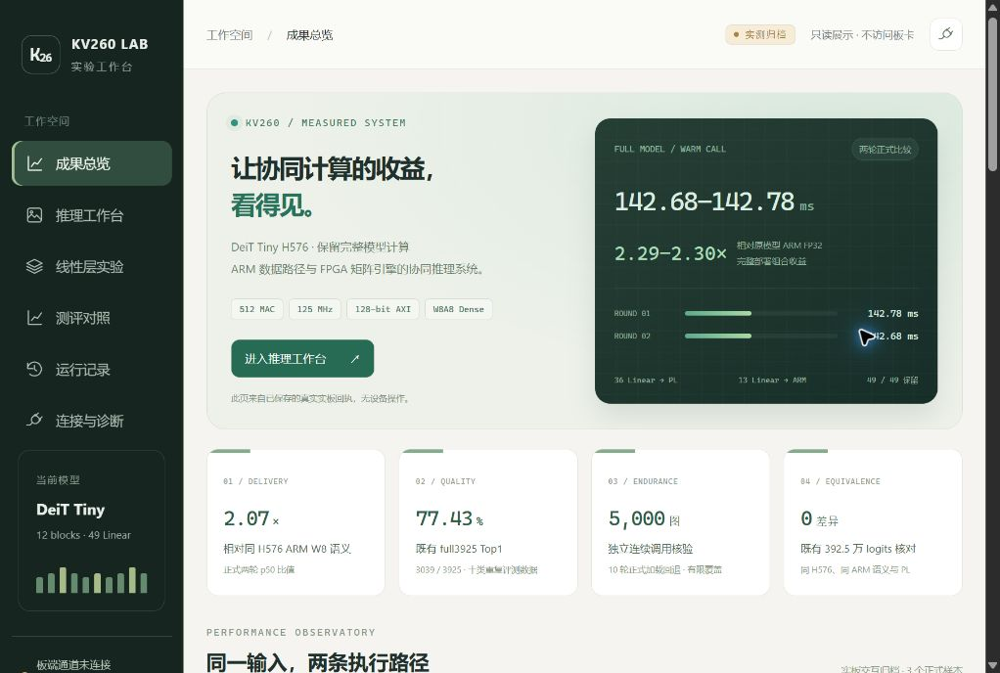
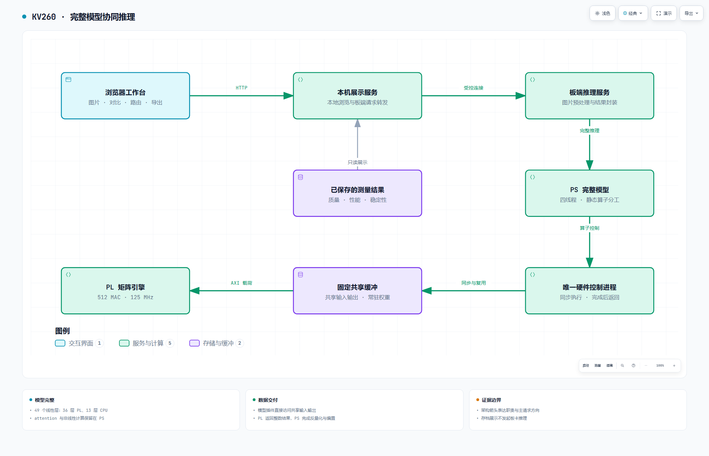
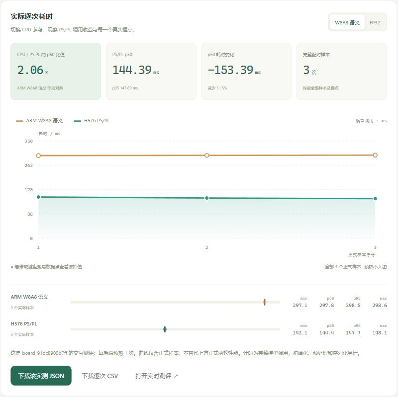

# KV260 · 完整模型协同推理

[完整交付与下载](https://github.com/GINSmucker/kv260-gemm-engine/tree/codex/team-handoff-20261007) · [网页使用指南](docs/workbench.md) · [冻结运行包](https://github.com/GINSmucker/kv260-gemm-engine/releases/tag/h576-summary-20261019)

本首页展示冻结 H576 的完整成果；默认开发树仍保留既有计算基线。运行工作台或复核 H576 时，请取得上方完整交付分支，按对应模型、平台和运行包使用。

将完整视觉模型部署到边缘 FPGA，需要同时做好计算、数据交付、模型质量和运行展示。本项目在 KV260 上实现 CPU 与 FPGA 的固定分工：保留完整模型计算，让适合卸载的矩阵运算进入可编程逻辑，其余计算由处理器完成。

当前成果采用冻结的 H576 紧凑模型与 Dense W8A8 数值路径。MLP 隐藏宽度为 576，包含十二个 Transformer 块和四十九个线性层，其中三十六层由 FPGA 执行、十三层由 CPU 执行。这是缩宽后的稠密模型，不是 2:4 稀疏加速器。

## 已取得的结果

| 观察维度 | 已有实测结果 | 解释范围 |
| --- | --- | --- |
| 完整推理延迟 | 两轮中位数 142.78 / 142.68 ms | 同板、固定四线程、预热后完整浮点输入至浮点输出 |
| 相对原模型 ARM FP32 | 约 2.295 / 2.294 倍 | 包含模型缩宽、PS 优化与 PL 交付的综合收益 |
| 相对同候选 ARM W8A8 | 约 2.070 倍 | 对照是数值语义参考，不是高性能 INT8 CPU 内核 |
| 既有质量集 | Top1 3039 / 3925，Top5 3729 / 3925 | 十类图像范围，Top1 比原 FP32 高 1.554 个百分点 |
| 模型结果 | 同 ARM 候选与 PL 的 3,925,000 个 logits 逐位一致 | 不扩展为跨主机逐位一致结论 |
| 有限连续运行 | 5,000 次推理、十轮正式加载回退 | 二十张公开图片重复使用，不能视为新增质量样本 |
| 浏览器交付 | 真实 PL 图片推理、性能对比、路由与下载已验证 | 新展示层另完成存档显示检查，未重跑其全部实时链路 |

计时不包含模型初始化、图片预处理、硬件加载、结果序列化和验算。连续运行的 p95 / p99 为 143.71 / 148.98 ms，最大值为 175.44 ms；有限样本不构成长期尾延迟上界。全部有效样本保留，失败运行仍属于验证记录。

## 为什么能够更快

主要收益来自减少实际重复工作。量化后的输入和整数输出复用固定共享缓冲，静态权重在初始化时装载。模型插件直接写入输入区并读取输出区，控制消息不携带大块矩阵。唯一硬件控制进程负责同步、启动和完成确认，保持简单的同步执行顺序。

处理器继续使用四线程执行已有计算。QKV 结果直接写入消费者所需布局；GELU 的外围算术减少中间遍历，同时保留原生 Erf 和既定浮点舍入顺序。attention 保留现有内核。硬件保持单引擎、512 MAC、125 MHz 和 128 位通路，优化结论以完整交付成本衡量。

## 架构与展示

架构图由 Archify 生成。[交互式架构说明](https://github.com/GINSmucker/kv260-gemm-engine/blob/codex/team-handoff-20261007/docs/diagrams/architecture.html)下载后可通过浏览器打开，支持缩放、关系追踪和主题切换；GitHub 页面本身不执行交互式 HTML。

工作台将正式性能、图片交互测评、模型质量和有限稳定性分区展示。性能对比采用 CPU 与 PS／PL 两条曲线，可以切换参考并查看各样本。曲线展示真实保存的测量值，不生成平滑趋势或替代缺失数据。路由视图说明四十九层的静态分工，不把它表达成逐层进度或逐层耗时。

## 阅读和使用

- [项目原理与当前状态](https://github.com/GINSmucker/kv260-gemm-engine/blob/codex/team-handoff-20261007/docs/progress.md)：理解模型、运行时、硬件及剩余边界。
- [打开和使用工作台](docs/workbench.md)：查看成果、运行图片、阅读性能和路由、下载结果。
- [证据与验收范围](https://github.com/GINSmucker/kv260-gemm-engine/blob/codex/team-handoff-20261007/docs/verification.md)：区分质量、性能、功能与有限稳定性结论。
- [接口与工程协作](https://github.com/GINSmucker/kv260-gemm-engine/blob/codex/team-handoff-20261007/docs/interface.md)：了解数值和执行职责。
- [启动本机工作台](https://github.com/GINSmucker/kv260-gemm-engine/blob/codex/team-handoff-20261007/start-workbench.ps1)：使用已有 PowerShell 7 和 Node.js 24 或更高版本运行，默认展示存档与演示功能。
- [按需交付资产](https://github.com/GINSmucker/kv260-gemm-engine/blob/codex/team-handoff-20261007/docs/locks/ASSETS.lock.json)：冻结模型、运行包和公开验证输入按身份取得。

## 当前交付边界

这是有实测证据的研究交付总结，尚不等于联合正式发布。新增两千张质量保留集仍未使用；既有质量结论不外推至完整 ImageNet 泛化。跨主机 W8 逐值一致检查仍有失败记录，Chrome 自动上传本机 JPEG 的扩展权限路径仍待验证。永久 AXI 卡死恢复、无限期运行保证和从全新系统重建环境也不在已通过范围内。

旧默认开发配置、正式资格参考和其他资源候选保留独立身份，不能与当前 H576 成果混用。取得源码和资产不自动授权加载共享板卡；真实推理需要维护者建立匹配窗口。仓库不包含两千张质量保留集或 C 私有留出材料。
