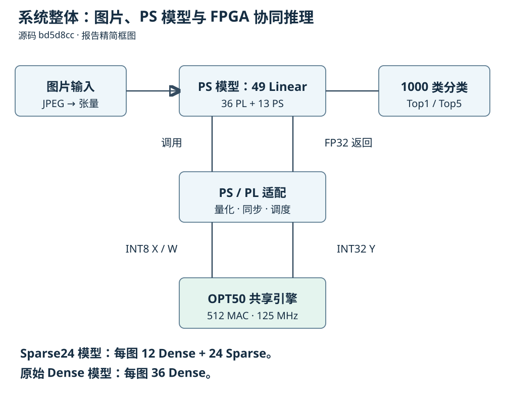
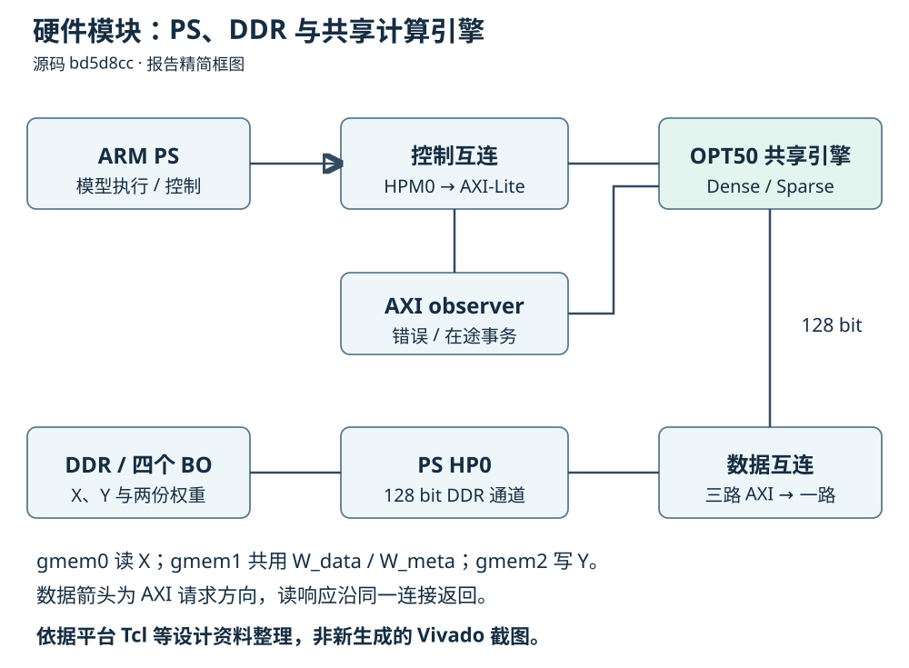
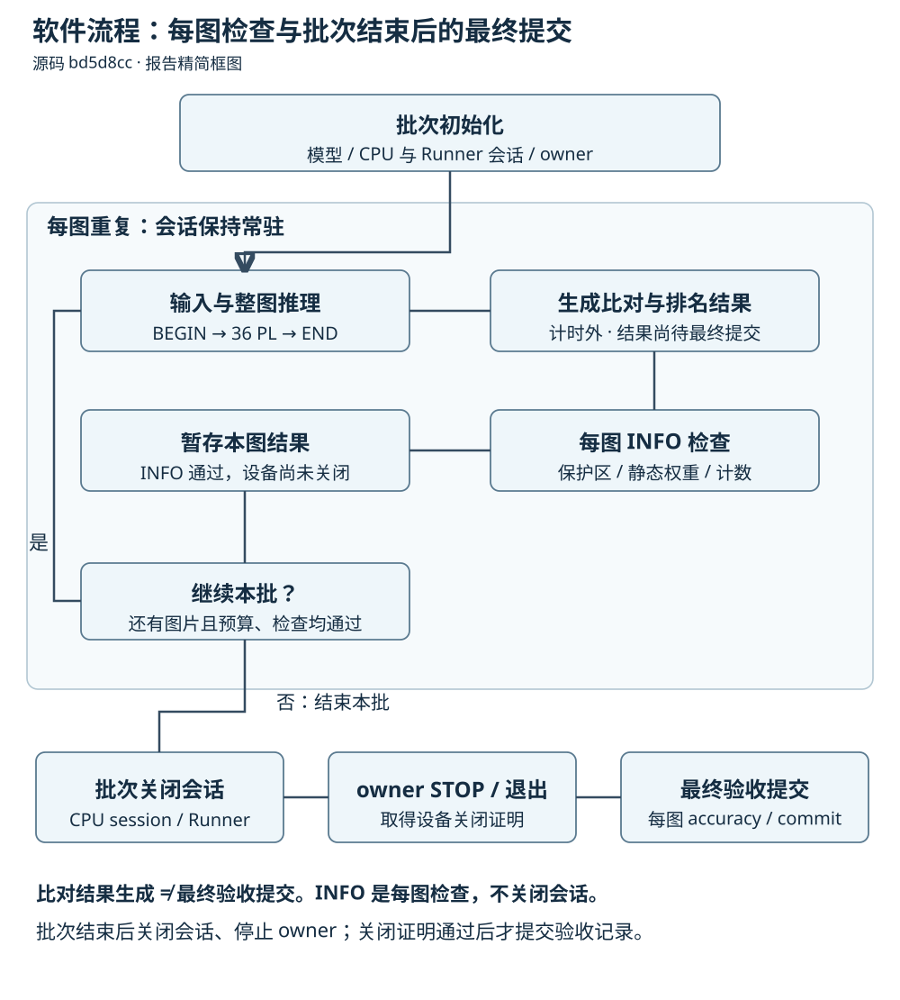
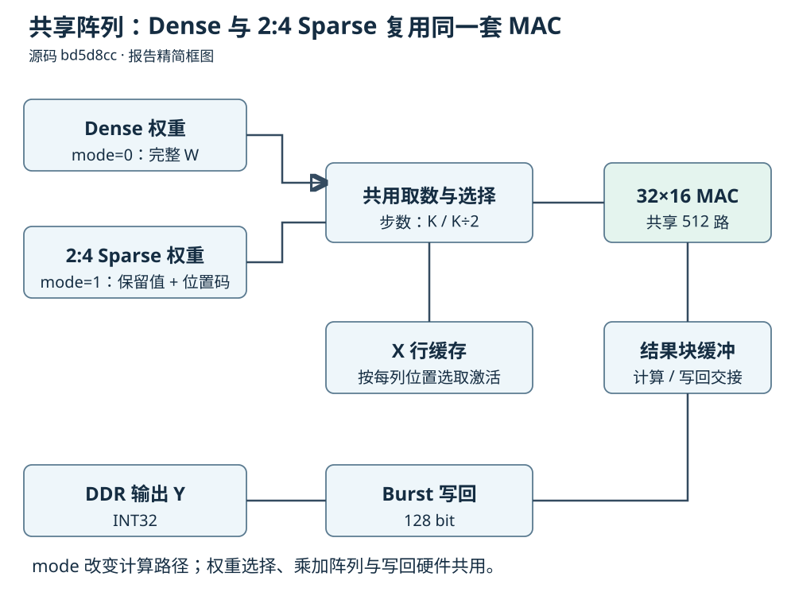

# KV260 OPT50：系统架构与主要技术实现

源码基准：`bd5d8cc056a12b19f757949324986079ea675b59`。

H576 的完整模型运行在 ARM PS，36 个 Linear 调用同一个 OPT50 FPGA 计算核。Sparse24 每图执行 12 次 Dense 和 24 次 2:4 Sparse；量化、反量化、attention 和分类输出由 PS 完成。

## 系统整体框图

[交互图](system/system.html) · [报告精简 SVG](report/system.svg) · [JSON 源](system/candidate.json)



## 硬件模块与主要数据通路

[交互图](hardware/hardware.html) · [报告精简 SVG](report/hardware.svg) · [JSON 源](hardware/candidate.json)



## 软件执行与正确性验收流程

[交互图](software/software.html) · [报告精简 SVG](report/software.svg) · [JSON 源](software/candidate.json)



## Dense / 2:4 Sparse 共用阵列

[交互图](shared-core/shared-core.html) · [报告精简 SVG](report/shared-core.svg) · [JSON 源](shared-core/candidate.json)



## 主要技术实现

### 整网分工：49 Linear，36 PL / 13 PS

每个 Transformer block 的 QKV、fc1、fc2 走 PL，proj 走 PS；12 个 block 加分类 head，共 49 个 Linear。Sparse24 只对 24 个 MLP Linear 使用稀疏模式，12 个 QKV 仍为 Dense。原始 Dense 对照通过同一个 IP 执行 36 次 Dense。

H576 的 MLP 中间维为 576。QKV/fc1 的 M/K/N 为 197/192/576，fc2 为 197/576/192；PS 的 proj 为 197/192/192，head 为 1/192/1000。核本身依据 M/K/N/mode 工作，模型层号与路由由软件固定。

源码：[board/runtime/snapshots/sparse24/source/route.h:1](https://github.com/GINSmucker/kv260-gemm-engine/blob/bd5d8cc056a12b19f757949324986079ea675b59/board/runtime/snapshots/sparse24/source/route.h#L1-L8) · [board/runtime/snapshots/sparse24/source/protocol.h:27](https://github.com/GINSmucker/kv260-gemm-engine/blob/bd5d8cc056a12b19f757949324986079ea675b59/board/runtime/snapshots/sparse24/source/protocol.h#L27-L36) · [board/runtime/snapshots/sparse24/source/model_core.hpp:32](https://github.com/GINSmucker/kv260-gemm-engine/blob/bd5d8cc056a12b19f757949324986079ea675b59/board/runtime/snapshots/sparse24/source/model_core.hpp#L32-L35)

### W8A8 数值：逐行量化，PS 保留浮点后处理

动态激活量化按行取最大绝对值，零行 scale 为 1，其余 scale 为 max(max_abs/127, FP32 最小正规数)。RNE 舍入后限制到 [-127,127]；权重 scale 按输出通道组织。硬件以有符号 INT8 相乘并完整累加为 INT32。

返回 Y 后，PS 按 float(Y) × sx × sw + bias 的既定顺序反量化。QKV 直接写入三个目标布局；量化、缓存同步和反量化属于完整模型计时的一部分。

源码：[board/runtime/snapshots/sparse24/source/quant_neon.h:16](https://github.com/GINSmucker/kv260-gemm-engine/blob/bd5d8cc056a12b19f757949324986079ea675b59/board/runtime/snapshots/sparse24/source/quant_neon.h#L16-L59) · [board/runtime/snapshots/sparse24/source/b_plugin.cpp:130](https://github.com/GINSmucker/kv260-gemm-engine/blob/bd5d8cc056a12b19f757949324986079ea675b59/board/runtime/snapshots/sparse24/source/b_plugin.cpp#L130-L176) · [board/runtime/snapshots/sparse24/source/qkv_dequant.h:1](https://github.com/GINSmucker/kv260-gemm-engine/blob/bd5d8cc056a12b19f757949324986079ea675b59/board/runtime/snapshots/sparse24/source/qkv_dequant.h#L1-L23)

### 2:4 数据格式：按 K 四元组、每列独立位置

对每个输出列 n，将 K 方向每 4 个权重分为一组，仅存两个保留值及 p0<p1 的位置。记录 t=g×N+n，W_data 的字节偏移为 2×t+s；位置码 code=p0|(p1<<2)。两个压缩权重与一个 4-bit 位置码分存在 W_data、W_meta，均按 128-bit 字传输。

不同输出列允许不同保留位置，不能给整行或整列广播同一个位置。保留值为零仍保留索引。Sparse 在计算前检查 metadata；Dense 不读取外部 W_meta。格式原文的创建时状态不是当前实现状态，当前能力以 OPT50 源码和接口文档为准。

源码：[hls/src/model_gemm_top.cpp:26](https://github.com/GINSmucker/kv260-gemm-engine/blob/bd5d8cc056a12b19f757949324986079ea675b59/hls/src/model_gemm_top.cpp#L26-L44) · [hls/src/model_gemm_core.hpp:50](https://github.com/GINSmucker/kv260-gemm-engine/blob/bd5d8cc056a12b19f757949324986079ea675b59/hls/src/model_gemm_core.hpp#L50-L68) · [hls/src/model_gemm_core.hpp:134](https://github.com/GINSmucker/kv260-gemm-engine/blob/bd5d8cc056a12b19f757949324986079ea675b59/hls/src/model_gemm_core.hpp#L134-L184)

### 共享计算阵列：mode 配置，不切换 bitstream

源码只有一个 model_gemm_top 和一处 selected_x × weights[nn] 乘法表达式，按 32 行、16 列展开。Dense 迭代 K 步，Sparse 迭代 K/2 步；模式选择改变权重地址、slot 和激活字节选择，共用累加器与 MAC 位置。

这是同一电路的运行时参数切换，不是每层动态部分重配置。512 个 MAC 位置也不等于整个分类网络每周期完成一帧；Sparse 算术步数减半不能直接换算成整网两倍加速。

源码：[hls/src/model_gemm_core.hpp:85](https://github.com/GINSmucker/kv260-gemm-engine/blob/bd5d8cc056a12b19f757949324986079ea675b59/hls/src/model_gemm_core.hpp#L85-L91) · [hls/src/model_gemm_core.hpp:132](https://github.com/GINSmucker/kv260-gemm-engine/blob/bd5d8cc056a12b19f757949324986079ea675b59/hls/src/model_gemm_core.hpp#L132-L187) · [hls/include/model_gemm_config.hpp:23](https://github.com/GINSmucker/kv260-gemm-engine/blob/bd5d8cc056a12b19f757949324986079ea675b59/hls/include/model_gemm_config.hpp#L23-L45)

### 供数与流水：行缓存、分 bank、结果块交接

X 按 32 行分 bank 并使用 LUTRAM；每行先读一个四元组，再按每列位置选择 INT8。W 使用 16 个 byte bank 的 BRAM。权重先从 DDR 加载至片上并验证，随后计算阶段在 N 微块内复用。DDR 中权重 BO 常驻不表示所有层权重永久驻留 PL。

shared_mac_steps 的流水目标为 II=1。compute_and_pack 与 write_output_blocks 位于 DATAFLOW 中，借助深度 2 的 stream_of_blocks 交接 16 行 slab，上半块另有暂存。该重叠属于单层计算与写回，尚未形成跨模型阶段或跨视频帧的整网流水。

源码：[hls/src/model_gemm_core.hpp:71](https://github.com/GINSmucker/kv260-gemm-engine/blob/bd5d8cc056a12b19f757949324986079ea675b59/hls/src/model_gemm_core.hpp#L71-L120) · [hls/src/model_gemm_core.hpp:189](https://github.com/GINSmucker/kv260-gemm-engine/blob/bd5d8cc056a12b19f757949324986079ea675b59/hls/src/model_gemm_core.hpp#L189-L258) · [hls/src/model_gemm_top.cpp:26](https://github.com/GINSmucker/kv260-gemm-engine/blob/bd5d8cc056a12b19f757949324986079ea675b59/hls/src/model_gemm_top.cpp#L26-L44)

### PS / PL 集成：控制与数据分离，四 BO 生命周期

PS HPM0 经控制 SmartConnect 访问 GEMM 和 observer。GEMM 的 gmem0 读 X，gmem1 共用 W_data/W_meta，gmem2 写 Y；三路 128-bit AXI 经数据 SmartConnect 进入 PS HP0 和 DDR。GEMM/observer 控制基址分别为 0xA0000000/0xA0010000。

唯一 Native owner 持有 CU 及 X、W_data、W_meta、Y 四个持久 BO。两份静态权重 BO 在初始化同步；client 导入 X/Y 的共享 FD，每层只同步有效 X/Y。缓冲含 64-byte 保护偏移并按 4 KiB 页分配。XRT 的 metadata 注册与实际固件装载是不同职责。

源码：[board/platform/scripts/create_system.tcl:133](https://github.com/GINSmucker/kv260-gemm-engine/blob/bd5d8cc056a12b19f757949324986079ea675b59/board/platform/scripts/create_system.tcl#L133-L211) · [board/runtime/snapshots/sparse24/source/kernel.cpp:125](https://github.com/GINSmucker/kv260-gemm-engine/blob/bd5d8cc056a12b19f757949324986079ea675b59/board/runtime/snapshots/sparse24/source/kernel.cpp#L125-L144) · [board/runtime/snapshots/sparse24/source/client.cpp:39](https://github.com/GINSmucker/kv260-gemm-engine/blob/bd5d8cc056a12b19f757949324986079ea675b59/board/runtime/snapshots/sparse24/source/client.cpp#L39-L66)

### 完成证明：Done 之外还要求 Idle 与 AXI 排空

每次执行前核验层序、地址、形状和 mode，写寄存器后完整读回，再进行 START。Done 为读清语义，由状态机锁存观察结果；还必须满足 Idle、Start/auto_restart 清除、observer 无在途事务及返回/AXI 错误为零，才允许结果提交。

BEGIN/END 约束每图恰好 36 次有序 PL 调用。每图先生成并保存比对结果，再由 INFO 完成保护区、静态权重与计数检查；结果保持 pending，下一 BEGIN 要求上一 INFO 已验证。同一会话可处理多图，最多 50 图、900 秒。批次结束才关闭 CPU/Runner、执行 owner STOP 并取得设备关闭证明，然后写入每图 accuracy 和 commit。完成未知时保留现场，不重放请求。

源码：[board/runtime/snapshots/sparse24/source/model_core.hpp:120](https://github.com/GINSmucker/kv260-gemm-engine/blob/bd5d8cc056a12b19f757949324986079ea675b59/board/runtime/snapshots/sparse24/source/model_core.hpp#L120-L168) · [board/runtime/snapshots/sparse24/run_model.py:484](https://github.com/GINSmucker/kv260-gemm-engine/blob/bd5d8cc056a12b19f757949324986079ea675b59/board/runtime/snapshots/sparse24/run_model.py#L484-L509) · [board/runtime/snapshots/sparse24/run_model.py:510](https://github.com/GINSmucker/kv260-gemm-engine/blob/bd5d8cc056a12b19f757949324986079ea675b59/board/runtime/snapshots/sparse24/run_model.py#L510-L542)

### 正确性与性能证据：同模型比较，区分测量边界

完整模型的 CPU 参考和 PL 路径使用同一输入、同一权重，按 FP32 原始位比较 logits，并独立在 1000 类上排名。原始 Dense 和 Sparse24 各有 500 张板测记录，各自比较 500,000 个 logits 且逐位差异为零。两模型权重不同，不要求跨模型 logits 相同。

同调度第 306～500 张的 Runner.run 平均耗时，Dense 为 143.494 ms，Sparse24 为 136.588 ms。该边界包含 PS、36 次 PL 调用及 client 同步，排除初始化、预处理、CPU 参考和完整后验检查。它不是纯 PL 周期、摄像头帧率或长稳吞吐数据；本地图文构建也不产生新的 HLS/RTL/实板验收。

源码：[board/runtime/snapshots/sparse24/model_worker.py:218](https://github.com/GINSmucker/kv260-gemm-engine/blob/bd5d8cc056a12b19f757949324986079ea675b59/board/runtime/snapshots/sparse24/model_worker.py#L218-L229) · [board/runtime/snapshots/sparse24/model_worker.py:365](https://github.com/GINSmucker/kv260-gemm-engine/blob/bd5d8cc056a12b19f757949324986079ea675b59/board/runtime/snapshots/sparse24/model_worker.py#L365-L405) · [docs/measurement.md:3](https://github.com/GINSmucker/kv260-gemm-engine/blob/bd5d8cc056a12b19f757949324986079ea675b59/docs/measurement.md#L3-L21)

## 历史图与当前版本的关系

|历史资料中的内容|当前解释|
|---|---|
|36 PL / 13 PS、512 MAC、125 MHz、128 bit|与当前主结构相符，可复用概念层次。|
|旧图中的网页 → 板端 agent → 推理服务|历史H576与Sparse24使用不同实时协议；KV260 LAB通过独立HTTP适配层连接已有Sparse24服务，归档数据和现场回执分别展示。|
|旧图中的通用 PL 矩阵引擎|需要明确 OPT50、运行时 mode、12D/24S、W_meta 和同一套共享阵列。|
|旧图中的固定共享缓冲|当前运行包为 X、W_data、W_meta、Y 四 BO；X/Y 由 client 同步。|
|历史网页曲线和质量、稳定性记录|保留 H576 Dense 的来源；不等同于当前 Sparse24 的 500 张精度和 195 张耗时。|

来源：[docs/diagrams/architecture.json:1](https://github.com/GINSmucker/kv260-gemm-engine/blob/bd5d8cc056a12b19f757949324986079ea675b59/docs/diagrams/architecture.json#L1-L10) · [docs/workbench.md:1](https://github.com/GINSmucker/kv260-gemm-engine/blob/bd5d8cc056a12b19f757949324986079ea675b59/docs/workbench.md#L1-L8) · [docs/version-history.md:1](https://github.com/GINSmucker/kv260-gemm-engine/blob/bd5d8cc056a12b19f757949324986079ea675b59/docs/version-history.md#L1-L17)

## 使用与复现

[统一阅读入口](index.html)。点击图中节点查看源码卡片；在图右上角导出 PNG、SVG 或其他支持格式。详细 SVG 是交互图的浅色静态快照，附关键说明；报告版 SVG 依据同一源码事实精简排版，保留每图检查、批末关闭及模型范围的限定。

使用本机已安装的 Archify 和 Node.js：

```powershell
python tools/build_architecture.py
```

脚本将图表校验记录保存在忽略的 `.test_build/.archify/`，更新文档图、阅读入口及 `results/architecture/opt50.json`。依赖的固定源码提交必须在本地 Git 对象库中。

## 适用范围

这组图基于固定 main 提交与归档源码，展示当前有效结构和原受检运行包机制。硬件图是 Tcl 整理的模块框图，不是新生成的 Vivado 截图。摄像头、跨帧流水和新板卡部署未实现或未验证。

交互查看器由 Archify 3.2.0 生成；保留 Apache-2.0、MIT、NOTICE 与第三方说明。
