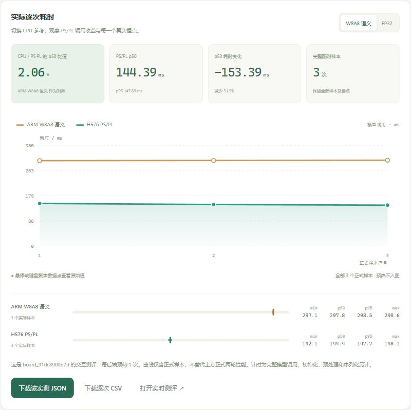

# 打开和使用工作台

## 准备与打开

先取得[完整交付分支](https://github.com/GINSmucker/kv260-gemm-engine/tree/codex/team-handoff-20261007)，可在该分支页面下载完整源码或按分支克隆；随后使用现有 PowerShell 7 运行[工作台启动入口](https://github.com/GINSmucker/kv260-gemm-engine/blob/codex/team-handoff-20261007/start-workbench.ps1)。本机需要 Node.js 24 或更高版本，无需安装前端依赖。启动入口会打印本机访问地址，默认端口为 4178；在 Chrome 地址栏输入该地址即可打开。保持终端运行，关闭终端或按 Ctrl+C 会停止服务。

若操作系统将脚本打开为文本，应选择使用 PowerShell 7 运行，或让维护者从终端调用启动入口。无需修改全局执行策略。端口被占用时，启动入口支持指定其他端口；服务会明确报错，不会结束其他程序。

默认启动包含已保存的实板成果和演示功能。查看总览不需要连接板卡，也不会触发硬件加载。浏览器必须显示本机工作台正文；不能把连接错误页或空白页作为验收成功。

## 成果总览

顶部展示模型、硬件规模和关键结果。正式性能、浏览器交互样本、质量和长时间运行分别呈现：正式两轮性能评估方案收益，少量交互样本展示操作体验，质量和有限稳定性说明不同验证维度。

性能区域同时绘制 CPU 参考与 PS／PL 两条曲线。切换参考项，可以比较同候选 FP32 或 W8A8 语义路径；悬停或使用键盘查看样本详情。横轴为样本顺序，纵轴为耗时。交互曲线只有实际保存的三个正式样本，不能替代完整性能分布，也不表示三个点之间发生了额外测量。

四十九层路由图表示静态分工：qkv、fc1、fc2 使用 PL，proj 和 head 使用 CPU。选中某层查看类型与执行位置。该图不是逐层运行进度，颜色不表示实时完成，路由清单不提供未经测量的逐层耗时。

## 连接真实板卡

真实任务要求维护者建立冻结运行包对应的硬件窗口，确认设备、驱动、缓冲和 owner 身份，并把板端服务通过受控隧道提供给本机。启动入口接受维护者提供的本机转发地址；浏览器依据当前板端能力显示可用后端。仅看到历史结果不表示板卡在线。

网页不负责刷写启动介质、重启板卡或切换底层运行包。失去连接时先确认原任务状态，不重复提交已进入硬件的请求。结束窗口应等待当前图完成、关闭会话、确认硬件静止并按约定回退。

## 图片推理

打开图片推理页，选择内置图卡或通过图片选择器选取本机图片。确认页面显示真实板端来源与对应后端，再发起一次推理。完成后查看预测类别、分数、计时和结果身份；任务未完成或失败时，页面不应填入推测结果。

真实 PL 的 Chrome 内置图卡路径已有验收。本机 JPEG 的自动上传仍受浏览器扩展文件访问权限限制，尚未验证；不要把内置图卡成功等同于所有本机上传方式成功。其他浏览器的图片路径证据也应按各自范围解释。

## 性能对比与下载

在性能对比页选择预热与正式次数，在同一板端窗口完成比较。预热不纳入正式分布，慢样本不能删除。模型运行耗时与整次浏览器请求等待不是同一边界：图片解码、传输、初始化和结果封装可能使用户等待更长。

在结果或历史页使用 JSON 与 CSV 下载入口。JSON 保留任务、模型身份及结果结构，CSV 便于查看样本数值。成果总览的下载明确标注为已保存测量，不代表本次新运行。下载后核对任务标识、样本数、后端和单位，并保留失败记录。

## 交互架构图

[Archify 架构说明](https://github.com/GINSmucker/kv260-gemm-engine/blob/codex/team-handoff-20261007/docs/diagrams/architecture.html)是独立网页。先下载到本机，再用浏览器打开；GitHub 预览不会执行其中的交互。读者可缩放画布、追踪连接、切换明暗主题，并使用查看器提供的导出功能。

[返回成果总览](https://github.com/GINSmucker/kv260-gemm-engine/blob/codex/team-handoff-20261007/README.md) · [当前状态](https://github.com/GINSmucker/kv260-gemm-engine/blob/codex/team-handoff-20261007/docs/progress.md) · [验证范围](https://github.com/GINSmucker/kv260-gemm-engine/blob/codex/team-handoff-20261007/docs/verification.md)
