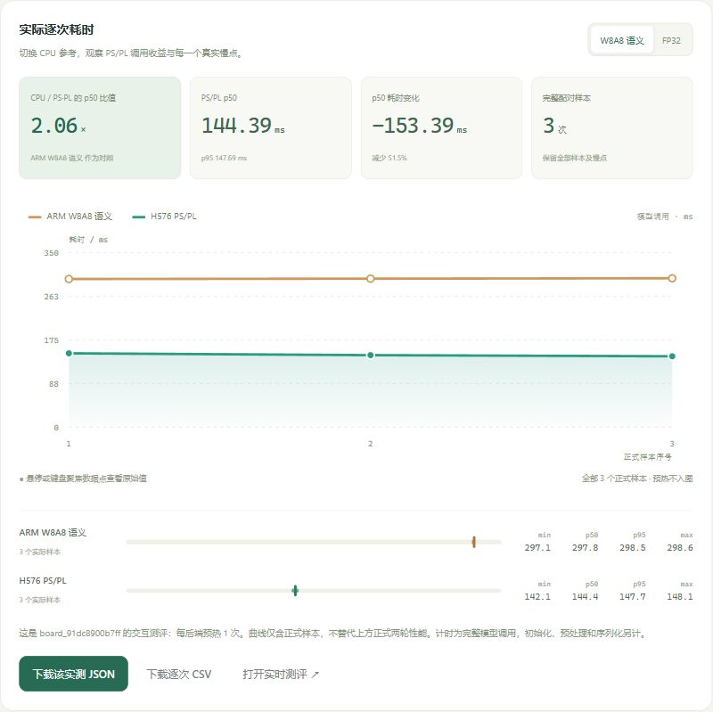

# C 的 H576 展示网站：打开与使用

这是 C 为 H576 Dense 制作的本机可视化工作台。默认可浏览已保存的实板成果、CPU／PS+PL 两条性能曲线、49 层静态路由，并下载 JSON／CSV；浏览存档不需要板卡或模型权重。

已经配置好展示服务的 Sparse24 板卡使用 **http://192.168.137.2:8080/#overview**，电脑以太网设置和真实图片推理步骤见[板端展示使用说明](boot-demo.md)。该板端应用已另外部署，部署程序与本轮网页证据尚未随仓库发布；本页继续说明仓库原有的 H576 本机工作台。

**网站保留原 H576 Dense 的数据和标识。** 页面中的 3,925 张质量结果、三点交互性能曲线和 5,000 次有限连续调用，属于原 H576 记录。当前 Sparse24 的 500 张精度和同调度195张耗时请看[首页结果表](../README.md#已取得的结果)与[最终数据](../results/README.md)，本网站尚未接入这些新数据。

## 启动与关闭

本机使用现有的 PowerShell 7、Node.js 24 或更高版本，以及浏览器。不需要 `npm install`，也不需要下载 Release 中的模型／固件。

在仓库根目录打开 PowerShell 7，执行：

```powershell
pwsh -File ./start-workbench.ps1
```

浏览器打开 **http://127.0.0.1:4178/#overview**。保持终端运行；按 Ctrl+C 可关闭本机网站。若端口被占用，指定其他端口：

```powershell
pwsh -File ./start-workbench.ps1 -Port 4180
```

此时打开 http://127.0.0.1:4180/#overview。无需修改全局执行策略；若本机策略阻止脚本，可在同一仓库根目录用已有 Node 直接启动：

```powershell
node --input-type=module -e 'import {createWorkbenchServer} from "./board/ui/server.mjs"; createWorkbenchServer().server.listen(4178,"127.0.0.1",()=>console.log("http://127.0.0.1:4178/#overview"));'
```

## 页面怎么用

- **成果总览**：查看 H576 历史模型、两轮正式性能、质量和有限稳定性。CPU参考可切换；曲线只有原先保存的3个正式交互样本，不能理解成完整500张分布。
- **路由图**：点击各层查看静态分工。qkv、fc1、fc2共36层在PL，proj和head共13层在CPU；颜色不表示实时进度或逐层耗时。
- **下载**：使用成果总览中的“下载该实测JSON”和“下载逐次CSV”，导出保存的交互记录，来源为`SAVED_MEASUREMENTS`。
- **演示交互**：未配置板端通道时，图片、单层和性能任务使用明确标注的`DEMO`合成数据，真实PL调用为0。它们用于展示操作流程，不构成新推理或精度证据。



## 本次保留的必要文件

| 文件 | 用途 |
|---|---|
| [start-workbench.ps1](../start-workbench.ps1) | 默认4178端口的本机启动入口 |
| [board/ui/](../board/ui/README.md)中的7个服务模块／配置文件 | HTTP服务、任务模型、存档读取和原H576响应校验 |
| `board/ui/public/`中的11个文件 | HTML、脚本、样式和3张SVG演示图 |
| `board/ui/tests/workbench.test.mjs`、`charts.test.mjs` | 原有本机功能、数据读取和下载检查 |
| [delivery_index.json](../results/model_planning/h576_closeout_20261016_01/delivery_index.json) | 原H576模型身份和展示来源索引 |
| [analysis.json](../results/model_planning/v5_h576_fair_20261016_02/analysis.json) | 原两轮正式性能 |
| [quality_recount.json](../results/model_planning/v5_h576_quality_20261016_01/quality_recount.json) | 原既有质量结果 |
| [C_ENDURANCE_RECEIPT.json](../results/C/h576/c_h576_endurance_20261016_02/C_ENDURANCE_RECEIPT.json) | 原有限连续调用证明 |
| [chrome_recount.json](../results/model_planning/v5_h576_ui_20261017_01/chrome_recount.json) | 原浏览器交互与下载记录 |
| [benchmark.json](../results/model_planning/v5_h576_ui_20261017_01/local_chrome/benchmark.json)、[pl.json](../results/model_planning/v5_h576_ui_20261017_01/local_chrome/pl.json) | 双曲线和49层路由实际读取的数据 |

以上28个原文件按字节取自`codex/v2-h576-dense`提交`71651c3`，沿用C的H576工作台。7个数据文件保持原路径和内容，存档读取器会校验其中引用的SHA256；缺文件或摘要不一致时会拒绝显示存档。

## 真实板端推理的前提

原H576还附有[可交互架构图](diagrams/architecture.html)，下载到本机后可由浏览器打开，支持缩放、关系追踪和主题切换。[版本说明](version-history.md)列出图、说明JSON、原验证记录和许可证的来源。

启动脚本原有`-BoardUrl`参数只用于维护者建立的、匹配旧H576运行包的本机SSH转发地址。旧网页的板端协议和身份校验不能直接接入当前OPT50 Sparse24 owner。本次没有迁入板端agent、旧固件、模型大文件，也不提供用旧网页启动当前Sparse24硬件的命令。

如需重现旧H576的实时图片功能，取得[原H576完整交付](https://github.com/GINSmucker/kv260-gemm-engine/tree/codex/v2-h576-dense)并按该分支的模型、平台和窗口要求操作。原Chrome证据覆盖内置图片路径；本机JPEG自动上传仍按原记录保留为待验证。

本次离线检查可在仓库根目录执行：

```powershell
node --test --test-isolation=none board/ui/tests/workbench.test.mjs board/ui/tests/charts.test.mjs
```

这只运行本机模拟／存档与HTTP检查，不连接板卡，不等于重新完成了浏览器实板验收。
